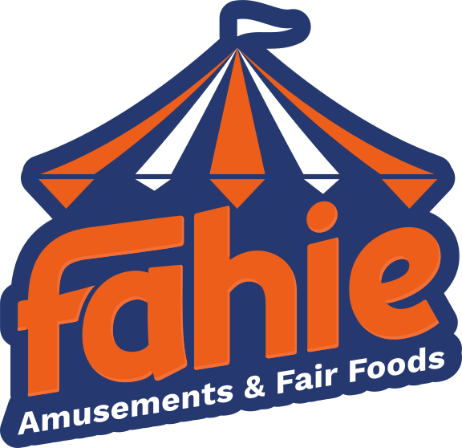

# Fahie Amusements & Fair Foods

 

The official website for Fahie Amusements & Fair Foods. The site presents the
company's fair-food offerings, amusement attractions, company information, and
upcoming event schedule in a responsive, image-led experience.

Production site: <https://fahieamusements.com>

## Features

- Branded landing page with hero imagery, promotional content, and contact
  information.
- Food showcase gallery for fried dough, blooming onions, Smokin Sips,
  snowcones, and fresh-squeezed lemonade.
- Amusement showcase for attractions such as Kiddy Striker.
- Upcoming events listing with dates, hours, locations, descriptions, and map
  links.
- Responsive layouts for desktop and mobile screens.
- Accessible image gallery controls with button-based navigation, alt text,
  pressed-state updates, and reduced-motion support.
- Local and GitHub-backed event content management through Keystatic.

## Pages

| Route | Purpose |
| --- | --- |
| `/` | Landing page with the hero, banner, site content, and footer |
| `/foods` | Food-joint placards and interactive image showcases |
| `/amusements` | Amusement attraction placards |
| `/about` | Company/about content |
| `/upcoming` | Upcoming events managed from the events collection |

## Tech stack

- **Astro 7** - Static site framework and component/page architecture.
- **TypeScript** - Configuration, content schemas, and type-safe project
  tooling.
- **Astro React integration** - React interoperability where needed.
- **Keystatic** - Content-management interface for upcoming events.
- **Netlify adapter** - Static deployment adapter.
- **Astro content collections** - JSON event loading and validation.
- **CSS** - Component-scoped styling, responsive media queries, CSS variables,
  and transitions.
- **Google Fonts** - Coiny for display typography and Comfortaa for supporting
  text.

## Integrations

### Astro React

Configured in `astro.config.mjs` with `@astrojs/react`. This enables React
components to be used alongside Astro components if interactive functionality
needs to be implemented with React.

### Keystatic

Keystatic manages the `events` collection:

- In development, it uses local storage.
- Outside development, it is configured for the
  `voy0/Fahie-Amusements-and-Fair-Foods` GitHub repository.
- Event entries are stored as JSON under `src/content/events`.
- The CMS fields include title, date, start/end hours, location, Google Maps
  URL, and short description.

The local Keystatic interface is available through the Astro integration while
running the development server.

### Netlify

The project uses `@astrojs/netlify` as its adapter. Astro is configured for
static output, making the generated site suitable for Netlify deployment.

## Project structure

```text
.
├── astro.config.mjs          # Astro, React, Keystatic, and Netlify setup
├── keystatic.config.ts       # Event CMS configuration
├── package.json              # Scripts and dependencies
├── public/                   # Public static assets, including the favicon
├── src/
│   ├── assets/               # Optimized/imported images and media
│   ├── components/           # Reusable Astro UI components
│   ├── content/events/       # JSON event records
│   ├── layouts/              # Shared document layout and global styles
│   └── pages/                # Route-level Astro pages
├── pictures/                 # Design/source imagery retained for project use
└── tsconfig.json             # Astro strict TypeScript configuration
```

## Key implementation details

### Shared layout and branding

`src/layouts/Layout.astro` provides the document shell, favicon, page title,
Google Font loading, global CSS variables, colors, typography, and base
responsive behavior. Shared navigation, hero backgrounds, content blocks, and
the footer are composed from `src/components`.

### Food and amusement showcases

Food and amusement pages define arrays of image objects with `src` and `alt`
values, then pass them into `ShowcaseWrapper.astro`. A showcase includes:

- An interactive `ImagesShowcase.astro` image stack.
- A title.
- An optional subtitle.
- Responsive sizing for mobile layouts.

The gallery uses buttons for image selection. Client-side JavaScript updates
the active card, accessible labels, `aria-pressed`, thumbnail offsets,
rotation, and stacking order. The gallery also respects
`prefers-reduced-motion`.

### Event content

Events are loaded from `src/content/events` through an Astro content
collection. `src/content.config.ts` uses a JSON glob loader and validates
event fields with Zod. `Events.astro` renders the collection for the
upcoming-events page.

### Image handling

Images imported from `src/assets` are processed by Astro's asset pipeline.
Food placard image filenames use lowercase `.jpg` extensions. Images provide
descriptive alt text, and non-initial gallery images are lazy-loaded to reduce
initial page cost.

